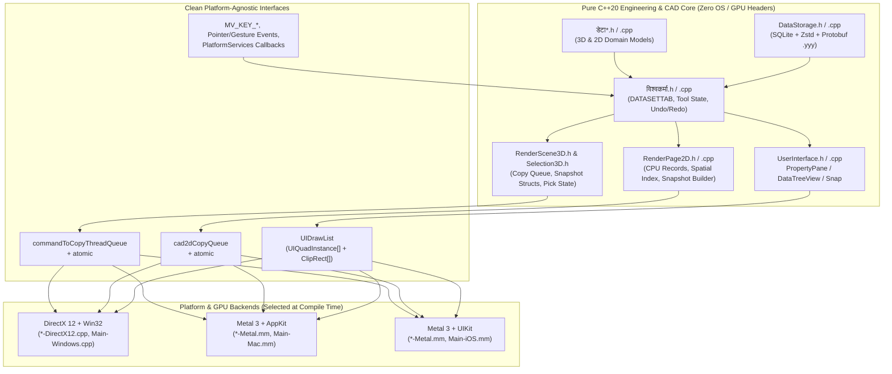

This chapter defines the complete architectural blueprint and step-by-step execution plan for bringing **Vishwakarma** to **macOS** (Apple Silicon `arm64` and Intel `x86_64`) and **iOS / iPadOS** (`arm64`), while enforcing a **strict compile-time boundary between engineering/domain code and graphics/platform code**.

---

## 1. Architectural Goals & Non-Negotiable Invariants

### 1.1 Target Baseline

| Dimension | macOS Target | iOS / iPadOS Target |
|---|---|---|
| **Minimum OS** | macOS 13.0 (Ventura) or later | iOS / iPadOS 17.0 or later |
| **CPU Architectures** | `arm64` (M1–M4+) & `x86_64` (Universal 2 binary) | `arm64` (device) & `arm64-apple-ios-simulator` |
| **Graphics API** | **Metal 3** (`MTLGPUFamilyMac2` / `MTLGPUFamilyApple7+`) | **Metal 3** (`MTLGPUFamilyApple7+` / A14+ / M-series iPad) |
| **Windowing & OS Layer** | **AppKit** (`NSApplication`, `NSWindow`, `NSView`, `CAMetalLayer`) | **UIKit** (`UIApplication`, `UIWindowScene`, `UIView`, `CAMetalLayer`) |
| **Language Bridge** | C++20 core + Objective-C++ (`.mm`) solely in `*-Metal.mm` / `*-Apple.mm` | C++20 core + Objective-C++ (`.mm`) solely in `*-Metal.mm` / `*-iOS.mm` |

### 1.2 The Five Rendering & Engineering Invariants

Every architectural guarantee established on Windows/DirectX 12 in [Graphics Engine](graphics.md), [2D Rendering Engine](2Drendering.md), and [Memory Management](memory.md) carries over unchanged to Metal:

1. **Strict Engineering / Rendering Separation**: No engineering header (`डेटा*.h`, `विश्वकर्मा.h`, `DataStorage.h`, `PropertyPane.h`, `DataTreeView.h`, `Snap.h`) may `#include` any DirectX (`<d3d12.h>`, `<dxgi*.h>`, `<wrl.h>`), Metal (`<Metal/Metal.h>`), Win32 (`<windows.h>`), AppKit, or UIKit header. Engineering code manipulates only CPU-side domain records, math structs, and lock-free command queues.
2. **Thread Ownership & Lock-Free Read-Copy-Update (RCU)**:
   - **Worker / Data threads** produce geometry and push `CommandToCopyThread` / `Cad2DCopyCommand` batches into lock-free/mutex-guarded queues.
   - **Copy thread (`copyThreadGPU`)** is the **sole writer** of GPU page arenas (`GeometryPage`, `Page2DGpuResources`), publishing immutable snapshots (`GeometryPageSnapshot`, `Cad2DPageSnapshot`) via `std::atomic<Snapshot*>` and retiring old pages behind monotonic GPU fence values (`copyFenceValue`, `lastUsedRenderFence`).
   - **Render thread (`renderThreadGPU`, 1 per monitor on macOS; 1 primary + optional external display `UIWindowScene` on iOS)** is a **pure reader** of the published snapshot and never blocks on CPU locks.
3. **Identical Binary GPU Struct Layouts**: All shared CPU/GPU structs (`PackedVertex16` = 16 B, `PackedVertex24` = 24 B, `InstanceData` = 64 B, `SceneCB` = 256 B, `CullConstants`, `GpuLineRecord2D` = 48 B, `GpuCurveRecord2D` = 64 B, `GpuTextGlyph2D` = 64 B, `UIQuadInstance` = 64 B) retain byte-for-byte identical sizes, alignments, and field offsets across HLSL and Metal Shading Language (MSL).
4. **Identical Left-Handed Coordinate System & `[0, 1]` NDC Depth**: Both D3D12 and Metal natively use a `[0, 1]` normalized device coordinate (NDC) Z range and top-left texture origin `(0, 0)`. All camera math (`XMMatrixLookAtLH`, `XMMatrixPerspectiveFovLH`) and shader projection math remain 100% identical without Y-flips or Z-remapping.
5. **Selector-Header Dispatch (No Virtual Call Overhead)**: Platform dispatch continues to use `GPUPlatformSelector.h` (`VISHWAKARMA_GPU_D3D12`, `VISHWAKARMA_GPU_METAL`, `VISHWAKARMA_GPU_VULKAN`) to include `*-DirectX12.h` or `*-Metal.h` ONLY inside rendering translation units.

---

## 2. Complete Audit of Platform Coupling in `code-core/`

Every file in `code-core/` has been audited and classified into one of three categories:

### 2.1 Category A — Already 100% Portable (Zero Changes Required)

| File(s) | Purpose | Why It Is Already Portable |
|---|---|---|
| `ID.h`, `CommonNamedNumbers.h`, `ConstantsApplication.h` | 64-bit entity IDs, compile-time constants, magic numbers | Pure `<cstdint>`, `<string_view>`, `<bit>`. |
| `MemoryManagerCPU.cpp` | Static storage definitions for `MEMORY_MANAGER_CPU` | Standard C++ only. |
| `डेटा-सामान्य-2D.h`, `डेटा-पाइप.h`/`.cpp`, `डेटा-संरचना.h`/`.cpp`, `डेटा-बिजली.h`, `डेटा-उपकरण.h`, `डेटा-गतिशील-मशीन.h`, `डेटा-स्थिर-मशीन.h` | 2D & 3D engineering domain models (piping, steel sections, structure, electrical, equipment, machinery) | Pure domain math and `ID` / `OptionalProperties` containers once `डेटा.h` is cleaned. |
| `DataStorageProtoHelpers.h` | Protobuf ↔ CPU record serialization helpers | Uses only `VishwakarmaStorage.pb.h` and `डेटा*.h`. |
| `PropertyPane.h`/`.cpp`, `DataTreeView.h`/`.cpp`, `Snap.h`/`.cpp` | Property inspector, hierarchy tree, 2D/3D object snap engine | Pure UI/CAD logic operating on `DATASETTAB`, `UIContext`, and `TabCad2DStorage` CPU vectors. |
| `SVGIconRenderer.h`/`.cpp` | LunaSVG + Blend2D rasterizer for ribbon icons | Pure C++ (`lunasvg`, `blend2d`). |
| `RenderScene3D.h`, `RenderCompositor.h`/`.cpp`, `UserInterface.h` | High-level 3D scene, compositor, and immediate-mode UI headers | Already designed as platform-agnostic headers. |
| `VishwakarmaExtension.cpp` | Standalone C++ extension test executable | Uses portable `<iostream>` (`stdin`/`stdout` binary streams) and `ExtensionIPC.pb.h`. |

### 2.2 Category B — Portable Engineering / UI Files with Accidental Win32 or DX12 Leaks

These files represent portable engineering, UI, or storage logic, but currently leak Windows/D3D12 headers, Win32 virtual-key macros, `HWND`/`RECT`, or `GetTickCount64()`. Every single leak is cataloged below:

| File | Exact Lines & Leaking Symbols | Required Fix |
|---|---|---|
| `डेटा.h` | Lines 17, 23–34: `#include <wrl.h>`, `#include <d3d12.h>`, `#include <dxgi1_6.h>`, `#include <d3dcompiler.h>`, `#include "d3dx12.h"`, `using namespace Microsoft::WRL;` (note: line 22 explicitly says `// This file must not depend on GPU manager`!). | **Delete lines 17 and 23–34.** `डेटा.h` uses zero D3D12/DXGI/WRL symbols; it only uses `<DirectXMath.h>` and `<DirectXPackedVector.h>`. |
| `डेटा-सामान्य-3D.h` | Line 8: `#include <d3d12.h>` | **Delete line 8.** `डेटा-सामान्य-3D.h`/`.cpp` uses only `<DirectXMath.h>`, `<DirectXPackedVector.h>`, and `डेटा.h`. |
| `GlobalVariables.cpp` | Lines 19–24: `#include "MemoryManagerGPU.h"`, `#include "d3dx12.h"`, `#include <dxgi1_6.h>`, `#include <wrl.h>`, `#include <d3dcompiler.h>`, `#include <DirectXMath.h>` | **Delete lines 19–24.** `GlobalVariables.cpp` only instantiates `GlobalVariables globals` and `activeDataSetNo`. |
| `OptionalProperties.h` | Line 501: `#include <immintrin.h>` and `generateFlagsToByte_AVX2_Refined` (unused benchmark function at bottom of file). | Guard line 501 to end of file with `#if defined(__AVX2__) ... #endif` so ARM64 (`arm64` macOS/iOS) builds cleanly. |
| `विश्वकर्मा.h` | Line 11: `#include "RenderPage2D-DirectX12.h"`; lines 60–97 (`SingleUIWindow`): `HWND hWnd`, `RECT tabBandRect`, `RECT viewBandRect`, `RECT contentRect`, `ApplyFramelessFrame()`; `DATASETTAB` holds `TabGeometryStorage geometry` (from `MemoryManagerGPU-DirectX12.h`), `SelectionState selection` (from `Selection3D-DirectX12.h`), and `std::unique_ptr<TabCad2DStorage> cad2d` (from `RenderPage2D-DirectX12.h`). | Replace `#include "RenderPage2D-DirectX12.h"` with `#include "RenderPage2D.h"` and `#include "Selection3D.h"`. Replace `HWND` with opaque `void* nativeWindowHandle` and `RECT` with portable `IntRect { int32_t left, top, right, bottom; }`. Move `ApplyFramelessFrame()` to the windowing backend. |
| `विश्वकर्मा.cpp` | Calls `GetTickCount64()`, checks Win32 `VK_*` (`VK_ESCAPE`, `VK_RETURN`, `VK_BACK`, `VK_DELETE`, `VK_F3`, `VK_F7`, `VK_F8`, `VK_SHIFT`, `VK_CONTROL`) and `WHEEL_DELTA`, and calls `MessageBoxA` / `MessageBoxW` in `ImportStdFileIntoTab` & `ImportDxfFileIntoTab`. | Replace `GetTickCount64()` with portable `SteadyClockMs()`; replace `VK_*` / `WHEEL_DELTA` with portable `MV_KEY_*` / `MV_WHEEL_DELTA` constants in `UserInputProcessing.h`; replace `MessageBoxA`/`W` with a platform dialog callback `PlatformShowAlert()`. |
| `DataStorage.h` & `DataStorage.cpp` | `DataStorage.cpp` line 51: `#include "MemoryManagerGPU-DirectX12.h"`; `SaveTabToYyy` / `LoadYyyIntoTab` pass `std::wstring::c_str()` to `sqlite3_open16()`. | Replace `#include "MemoryManagerGPU-DirectX12.h"` with `#include "RenderScene3D.h"` (which already declares `toCopyThreadMutex`, `commandToCopyThreadQueue`, `toCopyThreadCV`). Change `sqlite3_open16(wstring)` to `sqlite3_open_v2(utf8Path, ..., SQLITE_OPEN_READWRITE \| SQLITE_OPEN_CREATE, nullptr)` because `wchar_t` is 32-bit UTF-32 on macOS/iOS while `sqlite3_open16` requires 16-bit UTF-16! |
| `RenderPage2D.h` & `RenderPage2D.cpp` | `RenderPage2D.cpp` line 4: `#include "RenderPage2D-DirectX12.h"`; uses `GetTickCount64()`, `WHEEL_DELTA`, and `VK_ESCAPE`, `VK_RETURN`, `VK_BACK`, `VK_DELETE`, `VK_LEFT`, `VK_RIGHT`, `VK_HOME`, `VK_END`, `VK_SHIFT`, `VK_CONTROL`. | Move CPU-side `TabCad2DStorage` fields into `RenderPage2D.h` so `RenderPage2D.cpp` only includes `RenderPage2D.h`. Replace `GetTickCount64()`, `WHEEL_DELTA`, and `VK_*` with `SteadyClockMs()`, `MV_WHEEL_DELTA`, and `MV_KEY_*`. |
| `UserInterface.cpp` | Uses `GetTickCount64()` and `VK_BACK`, `VK_DELETE`, `VK_LEFT`, `VK_RIGHT`, `VK_HOME`, `VK_END`, `VK_RETURN`, `VK_ESCAPE`, `VK_PRIOR`, `VK_NEXT`, `VK_CONTROL`, `VK_SHIFT`. | Replace with `SteadyClockMs()` and `MV_KEY_*`. |
| `ApplicationTab.cpp` | Lines 138–145: checks Win32 `DMDO_90`, `DMDO_180`, `DMDO_270` in `SampleStats()`. | Replace with portable `MonitorOrientation` enum (`Landscape`, `Portrait90`, `LandscapeFlipped180`, `Portrait270`) on `OneMonitorController`. |
| `Input_UI_Network_File.h` | Line 29: `uint64_t time = GetTickCount64();` | Replace with `uint64_t time = SteadyClockMs();`. |
| `VirtualMemory.h` & `MemoryManagerCPU.h` | `VirtualMemory.h` already has POSIX `mmap`/`mprotect`/`madvise`! However, `MemoryManagerCPU.h` line 213 hardcodes `TOTAL_VIRTUAL_MEMORY = 16 TB` (fails on iOS) and line 592 only implements `GlobalMemoryStatusEx` under `#ifdef _WIN32`. | Configure `TOTAL_VIRTUAL_MEMORY` per platform (`16 TB` on Win/macOS, `32 GB` on iOS) and implement `#elif defined(__APPLE__)` physical/available memory query (`sysctl` + `os_proc_available_memory()`). |
| `FontManager.h` & `FontManager.cpp` | Line 11: `#include "preCompiledHeadersWindows.h"`, `<Windows.h>`, `LoadResource`/`FindResource` for `IDR_MAIN_FONT`, `GetModuleFileNameW`, and `C:\Windows\Fonts\...` paths. | Abstract font discovery into `ResolvePlatformFontPath()` / `LoadEmbeddedDefaultFont()`, supporting `.app/Contents/Resources/fonts/` on macOS/iOS and `/System/Library/Fonts/` fallbacks. |

### 2.3 Category C — Intentionally Platform-Specific Subsystems Requiring Apple Implementations

| Subsystem | Existing Windows / D3D12 Files | New Apple / Metal Files to Create |
|---|---|---|
| **GPU Memory & Paging** | `MemoryManagerGPU-DirectX12.h`/`.cpp` | `MemoryManagerGPU-Metal.h`/`.mm` (expand existing stub) |
| **3D Scene & GPU Culling** | `RenderScene3D-DirectX12.h`/`.cpp` | `RenderScene3D-Metal.h`/`.mm` |
| **3D GPU Pick & Selection** | `Selection3D-DirectX12.h`/`.cpp` | `Selection3D.h` (shared CPU state) + `Selection3D-Metal.h`/`.mm` |
| **Multi-Layer Compositor** | `RenderCompositor-DirectX12.h`/`.cpp` | `RenderCompositor-Metal.h`/`.mm` |
| **2D CAD GPU Backend** | `RenderPage2D-DirectX12.h`/`.cpp` | `RenderPage2D-Metal.h`/`.mm` (after moving CPU record logic to `RenderPage2D.cpp`) |
| **Immediate-Mode UI GPU** | `UserInterface-DirectX12.h`/`.cpp` | `UserInterface-Metal.h`/`.mm` |
| **Print & PDF Export** | `PrinterController.h`/`.cpp` (Win32 PrintDlgEx + GDI + DX12 tiles) | Split into `PrinterController.h`/`.cpp` + `PrinterController-DirectX12.cpp` + `PrinterController-Metal.mm` |
| **Shaders (20 files)** | `Shader*.hlsl` (compiled via `fxc`/`dxc` to `.cso`) | `Shader*.metal` (or single unified `VishwakarmaShaders.metal` compiled via `xcrun metal` to `default.metallib`) |
| **App Entry, Windowing & Input** | `Main.cpp` (`wWinMain`, `WndProc`, Win32 file dialogs, DXGI monitor enum) | Split into portable coordinator `AppRuntime.cpp` + `Main-Windows.cpp` + `Main-Mac.mm` (AppKit) + `Main-iOS.mm` (UIKit) |
| **Auth, Telemetry, Update, IPC** | `AccountManager.cpp`, `ImprovementData.cpp`, `SoftwareUpdate.cpp`, `ExtensionCommunications.cpp` | Isolate OS calls behind `PlatformServices-Windows.cpp` and `PlatformServices-Apple.mm` |

---

## 3. Strict Separation of Engineering Code from Rendering Code

Before writing a single line of Metal or Objective-C++, we must sever all compile-time links between the engineering/CAD layer and the GPU/OS layer.



### 3.1 Cross-Platform SIMD Math (`DirectXMath` on Clang / ARM64 NEON)

`डेटा.h`, `डेटा-सामान्य-3D.h`, `RenderScene3D.h`, and `RenderPage2D.h` use `DirectX::XMFLOAT3`, `XMFLOAT4`, `XMFLOAT4X4`, `XMUBYTE4`, `XMHALF4`, `XMVECTOR`, and `XMMATRIX`.
- **Key Fact**: Microsoft's [`DirectXMath`](https://github.com/microsoft/DirectXMath) is an MIT-licensed, header-only, cross-platform C++ library that **natively supports Clang/LLVM and ARM64 NEON intrinsics** (`_XM_ARM_NEON_INTRINSICS_`) as well as x86/x64 SSE2 (`_XM_SSE_INTRINSICS_`).
- **Action**:
  1. Vendor the 4 header files (`DirectXMath.h`, `DirectXMathConvert.inl`, `DirectXMathMatrix.inl`, `DirectXMathMisc.inl`, `DirectXMathVector.inl`, `DirectXPackedVector.h`, `DirectXPackedVector.inl`, `DirectXCollision.h`, `DirectXCollision.inl`) into `code-external/DirectXMath/Inc/` alongside a 25-line `sal.h` stub for non-MSVC compilers (`#define _In_`, `#define _Out_`, `#define _Use_decl_annotations_`, etc. — note that `code-external/DirectX-Headers` already provides these).
  2. Create a lightweight wrapper header `code-core/MathTypes.h` that includes `<DirectXMath.h>` and `<DirectXPackedVector.h>` (with `sal.h` shims on `__APPLE__` / `__linux__`).
  3. In `डेटा.h` and `डेटा-सामान्य-3D.h`, replace all `<d3d12.h>`, `<dxgi1_6.h>`, `<wrl.h>`, `<d3dcompiler.h>`, and `"d3dx12.h"` includes with `#include "MathTypes.h"`.

### 3.2 Splitting `TabCad2DStorage` (`RenderPage2D.h` vs `RenderPage2D-<Platform>.h`)

Currently, `RenderPage2D-DirectX12.h` defines `TabCad2DStorage`, which mixes CPU engineering records (`lineRecords`, `polylineRecords`, `recordIndex`, tool state, snap/selection sets) with `ComPtr<ID3D12Resource>` GPU buffers (`Page2DGpuResources`). Because `DATASETTAB` holds `std::unique_ptr<TabCad2DStorage> cad2d`, `विश्वकर्मा.h` is forced to `#include "RenderPage2D-DirectX12.h"`, pulling DirectX 12 into every file in the project!

**Refactoring Specification**:
1. **Move to `RenderPage2D.h` (100% Platform-Agnostic)**:
   - `GpuLineRecord2D` (48 B), `GpuCurveRecord2D` (64 B), `GpuTextGlyph2D` (64 B), `Page2DConstants` (256 B) — plain `float`/`uint32_t` POD structs.
   - `Cad2DRecordKind`, `Cad2DRecordLocation`, `Cad2DGpuSpan`, `Cad2DGpuLocation`, `Cad2DPreviewState`, `Cad2DPageSnapshot` (holding integer page indices and record counts), and `Cad2DCopyCommand` / `Cad2DCopyBatch`.
   - `TabCad2DStorage`:
     - All CPU record vectors (`lineRecords`, `polylineRecords`, `polygonRecords`, `circleRecords`, `ellipseRecords`, `arcRecords`, `textRecords`, `assetDefinitionRecords`, `assetInsertRecords`) + `recordIndex` + `cpuRecordsMutex`.
     - Selection & tool state (`selection2DMutex`, `selectedObjectIds`, `activeSubTab`, `creationMode`, `transformMode`, `preview`, `previewScratch`, `gridStates[MV_MAX_SUBTABS]`).
     - `std::atomic<const Cad2DPageSnapshot*> activeSnapshot{nullptr};`
     - Forward-declared opaque pointer for backend GPU pages: `struct TabCad2DGpuState; std::unique_ptr<TabCad2DGpuState> gpu;` (allocated and touched **only** by the copy thread and render thread inside `RenderPage2D-<Platform>.cpp/.mm`).
2. **Move ~650 lines of CPU Record & Geometry Expansion from `RenderPage2D-DirectX12.cpp` to `RenderPage2D.cpp`**:
   - `RebuildCad2DRecordIndex`, `UpsertRecordInVector`, `EraseRecordFromVector`, `ApplyCpuBatchToTab`.
   - All CPU-to-GPU primitive expansion functions: `ToGpuLineRecord`, `AppendPolylineLineRecords`, `AppendPolygonLineRecords`, `ToGpuCircleRecord`, `ToGpuEllipseRecord`, `ToGpuArcRecord`, `AppendTextRecordGeometry`, and `UpdateGridStateIfNeeded`.
   - Only the final GPU buffer suballocation, upload, and draw encoder calls remain in `RenderPage2D-DirectX12.cpp` and `RenderPage2D-Metal.mm`.

### 3.3 Splitting 3D Paging, Instance Registry & Selection State (`RenderScene3D.h`, `Selection3D.h`, `MemoryManagerGPU.h`)

Currently, `DATASETTAB` embeds `TabGeometryStorage geometry` (defined in `MemoryManagerGPU-DirectX12.h`) and `SelectionState selection` (defined in `Selection3D-DirectX12.h`).

**Refactoring Specification**:
1. **Create `code-core/Selection3D.h` (Platform-Agnostic)**:
   - Move `PickPurpose`, `SelectionState`, `kSelectionBlue`, `kPickBoxSize`, and `kNavCubeVisibleMs` out of `Selection3D-DirectX12.h` into `Selection3D.h`.
   - Keep `PickGpuResources` and GPU pick execution inside `Selection3D-DirectX12.h` / `Selection3D-Metal.h`.
2. **Make `TabGeometryStorage`, `GeometryPage`, `GeometryPageSnapshot`, `InstanceRegistry`, `GpuCopyStats`, `GpuRenderStats`, and `OneMonitorController` Platform-Agnostic in `MemoryManagerGPU.h`**:
   - Replace raw `ComPtr<ID3D12Resource> vertexBuffer; ComPtr<ID3D12Resource> indexBuffer; D3D12_GPU_VIRTUAL_ADDRESS ...` inside `GeometryPage` with a small opaque or platform-selected `PageGpuBuffers` struct (or `uintptr_t gpuHandle` / forward-declared `GeometryPageGpu*`) so `DATASETTAB` and `ApplicationTab.cpp` (`SampleStats()`) can inspect `pageCount`, `vertexBytesUsed`, `indexBytesUsed`, `activeInstanceCount`, and `GpuCopyStats` without pulling in `<d3d12.h>` or `<Metal/Metal.h>`.
   - Similarly, split `OneMonitorController` into portable monitor metadata/stats (`width`, `height`, `dpiScale`, `orientation`, `renderStats`, `boundWindowIndex`, `camera`) in `MemoryManagerGPU.h` and a backend `MonitorGpuContext*` owned by the render thread.

### 3.4 Portable Input Keycodes (`MV_KEY_*`), Clock (`SteadyClockMs`), and Window Rects

1. **In `UserInputProcessing.h`**:
   - Define portable virtual key constants matching standard ASCII/HID semantics (`MV_KEY_BACK = 0x08`, `MV_KEY_TAB = 0x09`, `MV_KEY_RETURN = 0x0D`, `MV_KEY_SHIFT = 0x10`, `MV_KEY_CONTROL = 0x11`, `MV_KEY_ESCAPE = 0x1B`, `MV_KEY_PRIOR = 0x21`, `MV_KEY_NEXT = 0x22`, `MV_KEY_END = 0x23`, `MV_KEY_HOME = 0x24`, `MV_KEY_LEFT = 0x25`, `MV_KEY_UP = 0x26`, `MV_KEY_RIGHT = 0x27`, `MV_KEY_DOWN = 0x28`, `MV_KEY_DELETE = 0x2E`, `MV_KEY_F3 = 0x72`, `MV_KEY_F7 = 0x76`, `MV_KEY_F8 = 0x77`, and `MV_WHEEL_DELTA = 120`).
   - Note: By assigning the exact same numeric values as Win32 `VK_*`, Windows `WndProc` requires zero translation overhead, while macOS (`NSEvent.keyCode`) and iOS (`UIKey.keyCode`) translate Apple HID/Carbon keycodes to `MV_KEY_*` at the windowing boundary (automatically mapping `Command ⌘` on Apple platforms to `MV_KEY_CONTROL` for standard shortcuts like `⌘A`, `⌘C`, `⌘V`, `⌘X`, while also supporting `Control` where appropriate).
   - Provide inline `uint64_t SteadyClockMs()` using `std::chrono::duration_cast<std::chrono::milliseconds>(std::chrono::steady_clock::now().time_since_epoch()).count()`.

---

## 4. 3D Graphics Engine on Metal (`*-Metal.h / .mm`)

### 4.1 Metal Device, Command Queues, and Fence Synchronization (`MemoryManagerGPU-Metal.h/.mm`)

| DirectX 12 Concept (`*-DirectX12`) | Metal 3 Equivalent (`*-Metal`) | Implementation Details |
|---|---|---|
| `ID3D12Device` | `id<MTLDevice>` | Created via `MTLCreateSystemDefaultDevice()`. On multi-GPU Intel Macs, prefer the high-performance discrete or Apple Silicon GPU. |
| Render `ID3D12CommandQueue` (`DIRECT`) | `id<MTLCommandQueue>` (Render Queue) | One render command queue per active monitor/window render thread (`[device newCommandQueueWithMaxCommandBufferCount:64]`). |
| Copy `ID3D12CommandQueue` (`COPY`) | `id<MTLCommandQueue>` (Copy/Blit Queue) | Dedicated copy queue owned exclusively by `copyThreadGPU`, encoding `id<MTLBlitCommandEncoder>` commands. |
| `ID3D12Fence` (`copyFence`, `renderFence`) | `id<MTLSharedEvent>` + `MTLSharedEventListener` | Monotonic 64-bit counter (`copyFence.signaledValue`). Copy thread encodes `[cmdBuf encodeSignalEvent:copyEvent value:nextCopyFence]`. Render thread either queries `copyEvent.signaledValue` on CPU (for snapshot activation) or encodes `[renderCmdBuf encodeWaitForEvent:copyEvent value:snapshot->requiredCopyFence]`. |
| `IDXGISwapChain3` (3 buffers, `DXGI_FORMAT_R8G8B8A8_UNORM`) | `CAMetalLayer` (`maximumDrawableCount = 3`, `MTLPixelFormatRGBA8Unorm`) | Configured with `framebufferOnly = NO` if readback/screenshot is requested, otherwise `YES`. Display sync driven by `CVDisplayLink` (macOS) or `CADisplayLink` (iOS). |
| Bindless / Descriptor Tables | Metal Argument Tables / Direct Buffer & Texture Array Binding | Metal natively binds `id<MTLBuffer>` at `[[buffer(N)]]` with byte offsets (`setVertexBufferOffset:atIndex:`) and texture arrays `array<texture2d<float>, 10>` at `[[texture(0)]]`. |

### 4.2 Unified Memory Architecture (UMA) vs. Upload Ring & RCU Geometry Pages

All Apple Silicon Macs (M1–M4) and all iOS/iPadOS devices have a **Unified Memory Architecture (UMA)** with hardware cache coherency between CPU and GPU, while older Intel Macs may have discrete GPUs.

1. **`GeometryPage` (16 MB Vertex Buffer + 16 MB Index Buffer)**:
   - Allocate with `MTLResourceStorageModePrivate` when using the `MTLBlitCommandEncoder` upload ring (which works identically on both Intel discrete GPUs and Apple Silicon UMA and triggers Apple's GPU lossless buffer compression controller).
   - **Upload Ring (`UploadQueue`)**: Keep the exact same lock-free multi-producer `UploadQueue` (`64 MB` ring buffer allocated with `MTLResourceStorageModeShared | MTLResourceCPUCacheModeWriteCombined`). Worker/copy threads memcpy vertex/index payloads into the mapped `.contents` pointer and push `PendingCopyOp`; `copyThreadGPU` records `[blitEncoder copyFromBuffer:ringBuffer sourceOffset:... toBuffer:pageBuffer destinationOffset:... size:...]` and signals `copySharedEvent`.
   - **RCU Snapshot Retirement**: Unchanged from DirectX 12. When a `GeometryPage` is defragmented or compacted into a new page, the old page is moved to `retiredPages` tagged with `retireFenceValue`. Once all active monitor render threads advance their `completedRenderFence` past `retireFenceValue`, the `id<MTLBuffer>` is returned to the free page pool or released.

### 4.3 `TiledInstanceBuffer` on Metal (640 MB `Instances` + 40 MB `InstanceSlotOf` + 80 MB `VisibilityMask`)

On DirectX 12, `TiledInstanceBuffer` uses `CreateReservedResource` + `ID3D12CommandQueue::UpdateTileMappings` on a `D3D12_HEAP_TYPE_DEFAULT` tile heap to reserve 640 MB of GPU virtual address space while committing 64 KB physical tiles only as `highWaterInstanceSlot` grows.

On Metal, `MTLHeapTypeSparse` supports sparse **textures**, not linear `MTLBuffer`s. We have two clean, zero-overhead mechanisms to achieve the exact same behavior on Apple platforms:

- **Mechanism A — Virtual Memory + `newBufferWithBytesNoCopy:` (Recommended on Apple Silicon UMA)**:
  1. Reserve the 640 MB (`10M × 64 B`) range in process virtual memory using `VirtualMemory::Reserve(size)` (`mmap(..., PROT_NONE, MAP_PRIVATE | MAP_ANON)` — costs **0 bytes** of physical RAM or iOS jetsam footprint!).
  2. As `EnsureCapacity(slotCount)` grows in 64 KB or 1 MB increments, call `VirtualMemory::Commit(pageAddr, chunkBytes)` (`mprotect(..., PROT_READ | PROT_WRITE)`) and bind the committed span via `[device newBufferWithBytesNoCopy:basePtr length:committedBytes options:MTLResourceStorageModeShared deallocator:nil]`.
  3. Because the base virtual address `basePtr` never moves and pages are committed in-place, CPU/GPU synchronization is zero-copy, and physical memory footprint scales strictly with active instance count!
- **Mechanism B — Power-of-Two `MTLResourceStorageModePrivate` Buffer Growth with RCU Retirement (Universal Fallback for Intel Discrete GPUs + iOS)**:
  1. Start with a small `MTLBuffer` (e.g., 64 K instances = 4 MB).
  2. When `highWaterSlot` exceeds capacity, allocate a 2× `MTLBuffer`, encode a GPU-to-GPU `[blitEncoder copyFromBuffer:oldBuf sourceOffset:0 toBuffer:newBuf destinationOffset:0 size:oldBytes]` on the copy queue before applying the new batch, publish the new buffer handle in the next `GeometryPageSnapshot`, and push `oldBuf` into the fence-gated `retiredBuffers` queue.

### 4.4 GPU Frustum / Orientation / Pick-Box Culling (`ShaderSceneCull`) & `MTLIndirectCommandBuffer`

In DirectX 12 (`RenderScene3D-DirectX12.cpp` + `ShaderSceneCull.hlsl`), the compute shader tests each active instance (`[numthreads(64, 1, 1)]`) and appends surviving instances to a `VisibleCommand` buffer (`56 bytes` per command: `VBV`, `IBV`, `RootConstant b1 = gpuInstanceIndex`, `DrawIndexedArguments`) with an atomic counter, consumed by `ExecuteIndirect`.

In Metal 3, `MTLIndirectCommandBuffer` (`ICB`) is the native equivalent of `ExecuteIndirect`, and it offers an even cleaner hardware path:

1. **Passing `gpuInstanceIndex` via `[[base_instance]]` (Zero Per-Draw Constant Buffer Needed!)**:
   - In Metal's `render_command::draw_indexed_primitives(primitive_type::triangle, index_count, index_buffer_pointer, instance_count, base_vertex, base_instance)`, the 6th argument (`base_instance`) is forwarded directly to the vertex shader as `uint gpuInstanceIndex [[base_instance]]`!
   - Furthermore, `index_buffer_pointer` in Metal's `draw_indexed_primitives` is a direct `device const ushort*` pointer (`pageIndexBuffer + indexOffsetBytes / 2`).
   - Therefore, each indirect command only needs **1 vertex buffer bind** (`cmd.set_vertex_buffer(pageVertexBuffer, vertexOffsetBytes, 0)`) and **1 indexed draw call** (`cmd.draw_indexed_primitives(...)`).
2. **Dense Compaction Pattern on Metal**:
   - To avoid sparse empty slots in the `MTLIndirectCommandBuffer` (or on devices where encoding ICBs from compute benefits from dense range execution):
     - **Pass 1 (`ShaderSceneCull` compute kernel, 64 threads/group)**: Identical logic to `ShaderSceneCull.hlsl`. Evaluates visibility bit, `minPixelSize` screen-space projection, 6 frustum planes (mode 0) or 2D NDC pick-box overlap (mode 1). Atomically increments `visibleCount` (`atomic_fetch_add_explicit`) and writes a compact 24-byte `SurvivingDraw { uint pageIdx; uint vertexOffsetBytes; uint indexOffsetBytes; uint indexCount; uint gpuInstanceIndex; uint pad; }` into `survivingDraws[slot]`.
     - **Pass 2 (`EncodeICB` compute kernel, 64 threads/group over `visibleCount`)**: Reads `survivingDraws[tid]` and writes `render_command cmd(icb, tid)` using a buffer table of page vertex/index device pointers (`PageDevicePtrs`). Also writes `MTLIndirectCommandBufferExecutionRange { 0, min(visibleCount, maxCommands) }` at `tid == 0`.
     - **Render Pass**: Calls `[renderEncoder executeCommandsInBuffer:icb indirectBuffer:executionRangeBuffer indirectBufferOffset:0]`.
   - This two-kernel sequence runs back-to-back in a single `id<MTLComputeCommandEncoder>` with a memory barrier (`[computeEncoder memoryBarrierWithScope:MTLBarrierScopeBuffers]`), completing in microseconds with zero CPU readback.

### 4.5 3D Render Passes (`RenderScene3D-Metal.mm` & `Selection3D-Metal.mm`)

Each monitor's 3D viewport renders into off-screen render targets owned by `RenderCompositor-Metal`:
- **Color Target**: `MTLPixelFormatRGBA8Unorm` (4× MSAA `MTLTextureType2DMultisample` resolved via `MTLStoreActionMultisampleResolve` into a single-sample texture, or single-sample when MSAA is disabled). On Apple Silicon Tile-Based Deferred Renderers (TBDR), setting the MSAA texture to `MTLStorageModeMemoryless` means the 4× MSAA color and depth tiles stay entirely inside on-chip tile SRAM (`0 bytes` of system DRAM bandwidth!).
- **Depth Target**: `MTLPixelFormatDepth32Float` (`MTLStorageModeMemoryless` for MSAA depth; `MTLStorageModePrivate` when single-sample depth is needed). Clear depth = `1.0f`, compare function = `MTLCompareFunctionLess`.
- **Pass Sequence inside `RenderScene3D-Metal.mm`**:
  1. **Sky Gradient Background**: Full-screen triangle (`vertex_id = 0..2`) with depth write disabled (`ShaderSkyGradientVertex` / `ShaderSkyGradientPixel`).
  2. **Opaque & Transparent CAD Geometry**: Binds `SceneCB` at `[[buffer(1)]]`, `Instances` at `[[buffer(2)]]`, `Materials` at `[[buffer(3)]]`, and executes the compacted `MTLIndirectCommandBuffer` (`ShaderSceneVertex_16` / `ShaderScenePixel`).
  3. **Selection Highlight Overlay**: Iterates over `tab.selection.selectedGpuSlots` (typically 1–100 items), binding the selected instance's page VB/IB and drawing with `ShaderSceneVertex_16` + `ShaderSceneHighlightPixel` (`depthCompareFunction = MTLCompareFunctionLessEqual`, slope-scale depth bias `-1.0f`, alpha blending enabled).
  4. **Navigation Cube (Top-Right Scissor Viewport)**: Sets `MTLViewport` to the top-right corner (`kNavCubeSizePx × kNavCubeSizePx`), clears depth in that rect, and draws the 36-vertex procedural bevelled cube with `ShaderCubeVertex` / `ShaderCubePixel` sampling the 6-face MSDF label texture array (`cubeFaceTextures[6]`).
- **GPU Pick Pass (`Selection3D-Metal.mm`)**:
  - Triggered only on hover/click/marquee events.
  - Renders into a tiny `128 × 128` off-screen MRT (`target0`: `MTLPixelFormatRG32Uint` for `uint2` 64-bit `ObjectID`; `target1`: `MTLPixelFormatR32Float` for linear view-space depth `viewZ`; depth: `MTLPixelFormatDepth32Float`).
  - Runs `ShaderSceneCull` in **Mode 1 (Pick-Box NDC Culling)** into the pick ICB, then renders surviving geometry with `ShaderScenePickVertex_16` / `ShaderScenePickPixel`.
  - Copies the requested sub-rect (`1×1` for hover/click, up to `128×128` for box selection) via `MTLBlitCommandEncoder` (`copyFromTexture:toBuffer:`) into a `MTLResourceStorageModeShared` readback buffer, waits on the pick command buffer completion, and runs the exact same spiral-search / marquee-set CPU logic already in `Selection3D-DirectX12.cpp`.

---

## 5. 2D Rendering Engine & Print Engine on Metal / CoreGraphics

### 5.1 2D CAD Viewport Rendering (`RenderPage2D-Metal.h / .mm`)

Once CPU record management and primitive expansion (`ToGpuLineRecord`, `ToGpuCircleRecord`, `AppendTextRecordGeometry`, etc.) are moved to `RenderPage2D.cpp` (Section 3.2), `RenderPage2D-Metal.mm` becomes a concise ~450-line Metal backend:

1. **GPU Page Allocation (`Page2DGpuResources`)**:
   - Each `Page2DGpuResources` holds three `id<MTLBuffer>`s (`linesBuffer`, `curvesBuffer`, `textBuffer`), grown geometrically (`max(needed * 2, 1024)`).
   - Because 2D CAD pages are small (typically a few MBs) and updated via RCU snapshots on `copyThreadGPU`, on Apple Silicon UMA they can use `MTLResourceStorageModeShared` (or `Private` via blit upload) gated by the existing `retiredPages` / `retiredSnapshots` fence lifecycle.
2. **Three Instanced Draw Calls per Active Page + Preview Page**:
   - **Pass 1 — Analytic Lines (`Shader2D_LineVertex` + `Shader2D_LinePixel`)**:
     - `[encoder drawPrimitives:MTLPrimitiveTypeTriangle vertexStart:0 vertexCount:6 instanceCount:page.lineCount]`.
     - Vertex shader reads `StructuredBuffer<GpuLineRecord2D>` (`[[buffer(1)]]`) indexed by `[[instance_id]]` and expands each segment into a screen-space quad (`[[vertex_id]]` 0..5) with 1.5 px anti-aliased feathering margins.
     - Pixel shader computes exact signed perpendicular distance to the segment, dash/dot pattern phase, and selection tint (`kSelectionBlue` when `selectionFlag != 0`), outputting pre-multiplied coverage alpha.
   - **Pass 2 — Analytic Conics / Curves (`Shader2D_CurveVertex` + `Shader2D_CurvePixel`)**:
     - `[encoder drawPrimitives:MTLPrimitiveTypeTriangle vertexStart:0 vertexCount:6 instanceCount:page.curveCount]`.
     - Evaluates circles, ellipses, and circular arcs analytically per pixel in world space with screen-space derivative (`fwidth` / `length(float2(dfdx, dfdy))`) stroke anti-aliasing, angular sweep clipping, and dash patterns.
   - **Pass 3 — World-Space MSDF Text (`Shader2D_TextVertex` + `Shader2D_TextPixel`)**:
     - `[encoder drawPrimitives:MTLPrimitiveTypeTriangle vertexStart:0 vertexCount:6 instanceCount:page.textGlyphCount]`.
     - Samples the shared 10-slot MSDF font atlas array (`array<texture2d<float>, 10> fontAtlases [[texture(0)]]`) managed by `FontManager`.

### 5.2 Print Engine & PDF Export (`PrinterController`)

Currently, `PrinterController.h`/`.cpp` combines:
1. Paper size catalog (`ISO A0–A4`, `ANSI A–E`, margins, landscape/portrait math) and tile subdivision math (`ComputeTileGrid`, `BuildTilePage2DConstants`) — **100% portable math**.
2. Win32 `PrintDlgExW` dialog, `HDC` / `StartDocW` / `StartPage` / `StretchDIBits` GDI spooling, and DirectX 12 off-screen `4096 × 4096` tile rendering + readback — **Windows/D3D12-specific**.

**Refactoring & Apple Implementation**:
1. **Split `PrinterController.cpp` into**:
   - `PrinterController.cpp` (Portable): Paper size database, DPI & margin calculation, tile camera matrix calculation (`BuildTilePage2DConstants` for 2D CAD and `BuildTileSceneCB` for 3D views).
   - `PrinterController-DirectX12.cpp` (Windows): Existing `PrintDlgExW`, GDI `StartDocW`/`StretchDIBits`, and D3D12 `4096 × 4096` tile readback.
   - `PrinterController-Metal.mm` (macOS & iOS):
2. **Two Printing Modes on Apple Platforms (`PrinterController-Metal.mm`)**:
   - **Mode A — High-DPI Metal Tile Rasterization (3D Views & Guaranteed 1:1 Shader Parity for 2D Views)**:
     - Allocates a reusable `4096 × 4096` off-screen `MTLPixelFormatRGBA8Unorm` texture + `MTLResourceStorageModeShared` staging buffer.
     - Loops over the page tiles, invoking `RenderPage2D::RenderTileToTarget` or `RenderScene3D::RenderTileToTarget` on a dedicated command buffer, blits the tile to the staging buffer, wraps it in a `CGDataProviderRef` / `CGImageRef`, and draws it into the active `CGContextRef` page (`CGContextDrawImage`).
   - **Mode B — Native Vector PDF / CoreGraphics Path for 2D CAD Sheets (Bonus Capability on macOS/iOS)**:
     - Because `TabCad2DStorage` stores exact vector records (`lineRecords`, `circleRecords`, `arcRecords`, `textRecords`), `PrinterController-Metal.mm` can also emit true resolution-independent vector PDF paths (`CGContextMoveToPoint`, `CGContextAddLineToPoint`, `CGContextAddArc`, `CTFontDrawGlyphs`) directly into a `CGPDFContext` when exporting 2D CAD sheets to PDF!
   - **OS Print Dialog Integration**:
     - **macOS**: `NSPrintInfo` + `NSPrintOperation` + `NSPrintPanel` (provides native macOS print preview, printer selection, paper size, and "Save as PDF" out of the box).
     - **iOS / iPadOS**: `UIPrintInteractionController` + custom `UIPrintPageRenderer` subclass (`drawPageAtIndex:inRect:`) for AirPrint and system PDF share sheet export.

---

## 6. Complete Shader Pipeline (HLSL → Metal Shading Language)

### 6.1 Inventory of All 20 Shaders in `code-core/`

| # | Existing HLSL File | Stage | Purpose | Target MSL Function Name (`VishwakarmaShaders.metal`) |
|---|---|---|---|---|
| 1 | `ShaderSceneCull.hlsl` | Compute (`cs_5_1`) | GPU frustum, orientation, min-pixel, and pick-box culling (`[numthreads(64,1,1)]`) | `kernel void ShaderSceneCull(...)` + `kernel void EncodeSceneICB(...)` |
| 2 | `ShaderSceneVertex_16.hlsl` | Vertex (`vs_5_1`) | Unpacks `PackedVertex16` (float3 pos + octahedral snorm16 normal) & `InstanceData` | `vertex SceneVSOut ShaderSceneVertex_16(...)` |
| 3 | `ShaderSceneVertex_24.hlsl` | Vertex (`vs_5_1`) | Parked 24-byte vertex format (float3 pos + float3 normal) | `vertex SceneVSOut ShaderSceneVertex_24(...)` |
| 4 | `ShaderScenePixel.hlsl` | Pixel (`ps_5_1`) | Hemisphere + 3-point CAD lighting + Fresnel rim + material table lookup | `fragment float4 ShaderScenePixel(...)` |
| 5 | `ShaderScenePickVertex_16.hlsl` | Vertex (`vs_5_1`) | Pick pass vertex transform + forwards 64-bit `ObjectID` & `viewZ` | `vertex PickVSOut ShaderScenePickVertex_16(...)` |
| 6 | `ShaderScenePickVertex_24.hlsl` | Vertex (`vs_5_1`) | Parked 24-byte pick vertex shader | `vertex PickVSOut ShaderScenePickVertex_24(...)` |
| 7 | `ShaderScenePickPixel.hlsl` | Pixel (`ps_5_1`) | Outputs MRT `uint2` (`ObjectID`) to `color(0)` and `float` (`viewZ`) to `color(1)` | `fragment PickPSOut ShaderScenePickPixel(...)` |
| 8 | `ShaderSceneHighlightPixel.hlsl` | Pixel (`ps_5_1`) | Renders selection tint (`kSelectionBlue`) over selected 3D instances | `fragment float4 ShaderSceneHighlightPixel(...)` |
| 9 | `ShaderCubeVertex.hlsl` | Vertex (`vs_5_1`) | Procedural 36-vertex chamfered navigation cube + face UV + hover highlight | `vertex CubeVSOut ShaderCubeVertex(...)` |
| 10 | `ShaderCubePixel.hlsl` | Pixel (`ps_5_1`) | Bevel lighting + 6-face MSDF text label sampling (`Texture2D faceTex[6]`) | `fragment float4 ShaderCubePixel(...)` |
| 11 | `ShaderSkyGradientVertex.hlsl` | Vertex (`vs_5_1`) | Full-screen triangle (`SV_VertexID` 0..2) at `z = 1.0` | `vertex SkyVSOut ShaderSkyGradientVertex(...)` |
| 12 | `ShaderSkyGradientPixel.hlsl` | Pixel (`ps_5_1`) | Vertical horizon-to-zenith gradient interpolation | `fragment float4 ShaderSkyGradientPixel(...)` |
| 13 | `Shader2D_LineVertex.hlsl` | Vertex (`vs_5_1`) | Expands `GpuLineRecord2D` into anti-aliased screen-space quad | `vertex Line2DVSOut Shader2D_LineVertex(...)` |
| 14 | `Shader2D_LinePixel.hlsl` | Pixel (`ps_5_1`) | Signed distance to segment + dash/dot pattern + AA coverage | `fragment float4 Shader2D_LinePixel(...)` |
| 15 | `Shader2D_CurveVertex.hlsl` | Vertex (`vs_5_1`) | Expands `GpuCurveRecord2D` (circle/ellipse/arc) bounding quad | `vertex Curve2DVSOut Shader2D_CurveVertex(...)` |
| 16 | `Shader2D_CurvePixel.hlsl` | Pixel (`ps_5_1`) | Analytic implicit conic distance + angular arc mask + dash phase | `fragment float4 Shader2D_CurvePixel(...)` |
| 17 | `Shader2D_TextVertex.hlsl` | Vertex (`vs_5_1`) | World-space oriented MSDF glyph quad (`GpuTextGlyph2D`) | `vertex Text2DVSOut Shader2D_TextVertex(...)` |
| 18 | `Shader2D_TextPixel.hlsl` | Pixel (`ps_5_1`) | Median-of-3 MSDF reconstruction across `Texture2D atlases[10]` | `fragment float4 Shader2D_TextPixel(...)` |
| 19 | `ShaderUIVertex.hlsl` | Vertex (`vs_5_1`) | Instanced UI quad (`UIQuadInstance` 64 B) with rounded corners & clip rect | `vertex UIVSOut ShaderUIVertex(...)` |
| 20 | `ShaderUIPixel.hlsl` | Pixel (`ps_5_1`) | SDF rounded box, border stroke, MSDF text (`mode 1`), RGBA icon (`mode 2`) | `fragment float4 ShaderUIPixel(...)` |

*(Note: `VertexShader.hlsl` and `PixelShader.hlsl` are legacy unused files from initial bring-up and are not referenced by any code.)*

### 6.2 Register-to-Metal Slot Mapping & Matrix Convention

To keep all C++ structs and shader math 100% identical between HLSL and MSL:
- **Matrix Multiplication Order**: HLSL uses `mul(vec, mat)` with row-major matrices (`row_major float4x4` or `XMMatrixTranspose` depending on CB upload). Currently, `RenderScene3D-DirectX12.cpp` uploads `XMMatrixTranspose(viewProj)` into `SceneCB` so HLSL `mul(worldPos, viewProj)` computes column-vector multiplication `mat * vec`. In MSL (`metal::float4x4`), `mat * vec` is column-major multiplication — which expects the exact same memory layout as HLSL's transposed `float4x4`! Thus, in MSL, `mul(v, M)` maps directly to `M * v` with **zero change** to CPU constant buffer filling!
- **Texture Arrays (`Texture2D atlases[10] : register(t0)` + `NonUniformResourceIndex`)**:
  - In Metal 3 (`-std=metal3.0`), fragment shaders accept `array<texture2d<float>, 10> atlases [[texture(0)]]` and `sampler linearSampler [[sampler(0)]]`, indexing `atlases[in.atlasIndex].sample(linearSampler, in.uv)` directly without descriptor heaps.
- **Build-Time Compilation**:
  - Compile `.metal` → `.air` via `xcrun -sdk macosx metal -std=metal3.0 -O3` (or `-sdk iphoneos metal`) and link into `default.metallib` via `xcrun metallib`, bundled inside `Vishwakarma.app/Contents/Resources/default.metallib` (or embedded as a `constexpr uint8_t[]` header via a Python script just like `GenerateIcons.ps1` so single-binary tools/tests work without bundle path lookups).

---

## 7. Windowing, Multi-Monitor, Compositor, and Input (macOS AppKit vs. iOS UIKit)

### 7.1 Splitting `Main.cpp` into Portable Coordinator + Platform Host Files

Currently, `Main.cpp` (1,622 lines) contains both portable application orchestration (initializing `MEMORY_MANAGER_CPU`, `FontManager`, `SVGIconRenderer`, `DATASETTAB`, routing mouse/keyboard into `UserInterface` / `RenderPage2D` / `Selection3D`) and Win32-specific `wWinMain`, `WndProc`, `WM_NCCALCSIZE` frameless window border hit-testing, and `IFileOpenDialog`.

**Target Split**:
1. **`AppRuntime.h` / `AppRuntime.cpp` (Portable C++)**:
   - `AppRuntime::Initialize()`, `AppRuntime::Shutdown()`.
   - `AppRuntime::OnResizeWindow(int windowIndex, uint32_t widthPx, uint32_t heightPx, float dpiScale)`.
   - `AppRuntime::OnPointerEvent(int windowIndex, const PointerEvent& ev)` (unified mouse + touch + Apple Pencil struct).
   - `AppRuntime::OnKeyEvent(int windowIndex, uint32_t mvKey, bool isDown, uint32_t modifiers)` & `AppRuntime::OnTextInput(int windowIndex, std::u32string_view utf32Chars)`.
   - `AppRuntime::RenderWindowFrame(int windowIndex)` (invoked by the monitor's render thread).
2. **`Main-Windows.cpp`**: Existing `wWinMain`, `WndProc`, `WM_NCHITTEST` frameless resize border, Win32 `IFileOpenDialog`/`IFileSaveDialog`.
3. **`Main-Mac.mm` (macOS AppKit)**:
   - Custom `NSApplicationDelegate` + `NSWindow` configured with:
     ```objc
     window.styleMask = NSWindowStyleMaskTitled | NSWindowStyleMaskResizable |
                        NSWindowStyleMaskMiniaturizable | NSWindowStyleMaskClosable |
                        NSWindowStyleMaskFullSizeContentView;
     window.titlebarAppearsTransparent = YES;
     window.titleVisibility = NSWindowTitleHidden;
     ```
   - This gives Vishwakarma a **frameless full-bleed Metal window** while preserving native macOS window animations, Mission Control, Stage Manager, green-button tile/fullscreen menu, and native resize cursors!
   - **Traffic Light Reservation**: On macOS, reserve a `76 px × 32 px` inset on the left edge of the top tab bar in `UserInterface.cpp` (`globals.windowControlsLeftInsetDip = 76.0f` on macOS, `0.0f` on Windows/iOS) so the native macOS Red/Yellow/Green window buttons sit cleanly inside the dark tab band, and hide the Windows-style top-right `_ / □ / X` buttons on macOS (`globals.drawCustomWindowCaptionButtons = false`).
   - **Multi-Monitor Support**: Enumerates `[NSScreen screens]`, creating up to `MAX_MONITORS` windows (`OneMonitorController` per screen) driven by per-display `CVDisplayLinkRef` (or `CADisplayLink` on macOS 14+).
4. **`Main-iOS.mm` (iOS / iPadOS UIKit)**:
   - `UIApplicationDelegate` + `UISceneDelegate` + `VishwakarmaMetalViewController` (`UIViewController` hosting a `UIView` whose `+layerClass` is `[CAMetalLayer class]`).
   - Queries `window.safeAreaInsets` (`top`, `bottom`, `left`, `right`) so the top tab band clears the iPad status bar / iPhone Dynamic Island and the bottom status bar clears the Home indicator.
   - Frame pacing driven by `CADisplayLink` (`preferredFrameRateRange = CAFrameRateRangeMake(60, 120, 120)` for 120 Hz ProMotion iPads).
   - Supports external monitor connection on iPadOS via `UISceneSessionRoleExternalDisplayNonInteractive` (mapping the external display to `gpu.screens[1]`).

### 7.2 Multi-Touch, Trackpad, and Apple Pencil Input Translation (macOS & iOS)

While macOS supports standard mouse + keyboard + Magic Trackpad gestures (`magnifyWithEvent:`, `rotateWithEvent:`, `scrollWheel:`), iOS/iPadOS requires a dedicated **Touch + Apple Pencil Gesture State Machine** inside `Main-iOS.mm` that translates touches into Vishwakarma's existing 3D camera, 2D CAD, and UI events:

| User Action on iPad / iPhone | 3D Viewport Mapping | 2D CAD Viewport Mapping | UI Chrome (Ribbon / Panes) |
|---|---|---|---|
| **1-Finger Tap** | Single-object GPU Pick (`PickPurpose::Click`) or Nav Cube face click | Select entity / place CAD vertex (`OnLeftClick`) | Button click / tree node expand / text caret place |
| **1-Finger Drag (Touch)** | **3D Orbit** (`Camera::Orbit(dx, dy)`) | Active tool drag, or **Box Selection** when starting on empty canvas | Scrollbar drag / splitter resize / text selection |
| **Apple Pencil (`UITouchTypePencil`) Hover & Drag** | Hover highlight (`UIHoverGestureRecognizer` on M2/M4 iPad) + **Box Selection** or active 3D tool | Precision **Snap Hover** (`OnMouseMove`) + CAD drawing/grip drag | Standard pointer click/drag |
| **2-Finger Pinch (`UIPinchGestureRecognizer`)** | **Camera Zoom** (`OnMouseWheel` equivalent centered at pinch midpoint) | **2D Zoom around Pinch Anchor** (`ZoomAtScreenPoint`) | Ignored |
| **2-Finger Pan (`UIPanGestureRecognizer`, `minimumNumberOfTouches = 2`)** | **3D Camera Pan** (`MiddleMouseDrag` equivalent) | **2D Canvas Pan** (`MiddleMouseDrag` equivalent) | Vertical/horizontal scroll in `DataTreeView` / `PropertyPane` |
| **Long Press (`500 ms`)** | Context action / additive multi-select toggle (`Shift+Click` equivalent) | Additive multi-select or right-click cancel/finish polyline (`OnRightClick`) | Tooltip display |
| **2-Finger Tap / 3-Finger Tap** | **Undo / Redo** or Cancel active command (`MV_KEY_ESCAPE`) | Finish/Cancel active 2D tool (`OnRightClick` / `MV_KEY_ESCAPE`) | Dismiss active dropdown/popup |

### 7.3 Virtual Keyboard (`UIKeyInput`) on iOS for `UITextEditState` & `CREATE_TEXT`

Vishwakarma renders all text fields (`PropertyPane` numeric inputs, `ImprovementData` feedback modal, `AccountManager` login fields, and 2D CAD `CREATE_TEXT`) in its own immediate-mode GPU UI using `UITextEditState` (`UserInterface.h`).
- On **iOS/iPadOS**, when no hardware Magic Keyboard is attached, focusing any `UITextEditState` or entering `Cad2DCreationMode::CREATE_TEXT` must raise the iOS software keyboard:
  - `VishwakarmaMetalView` conforms to `<UIKeyInput, UITextInputTraits>`.
  - In `AppRuntime::RenderWindowFrame`, after `UserInterface::EndFrame()`, check `bool wantsTextInput = (uiContext.activeTextEditId != 0) || (activeTab.cad2d && activeTab.cad2d->creationMode == Cad2DCreationMode::CREATE_TEXT)`.
  - When `wantsTextInput` transitions `false → true`, call `[metalView becomeFirstResponder]` on the main thread; when `true → false`, call `[metalView resignFirstResponder]`.
  - Forward `insertText:(NSString*)text` as UTF-32 codepoints to `UserInterface::OnChar` / `RenderPage2D::OnChar`, and `deleteBackward` as `MV_KEY_BACK`.
  - Subscribe to `UIKeyboardWillChangeFrameNotification` so if an input field in the lower half of `PropertyPane` is covered by the virtual keyboard, the pane scroll offset adjusts automatically.

---

## 8. OS Services: Virtual Memory, Fonts, Storage, Networking, Updates & Extensions

### 8.1 Virtual Memory & iOS Address Space Limits (`VirtualMemory.h` & `MemoryManagerCPU.h`)

`VirtualMemory.h` already implements POSIX `mmap`, `mprotect`, `madvise`, and `munmap`! However, three critical Apple/iOS behaviors must be handled:

1. **iOS Virtual Address Space Limit (`16 TB` → `32 GB` on iOS)**:
   - In `MemoryManagerCPU.h` line 213, `TOTAL_VIRTUAL_MEMORY` is hardcoded to `16ULL * 1024 * 1024 * 1024 * 1024` (16 TB).
   - On **macOS (`TARGET_OS_OSX`)**, 64-bit processes have a 47-bit user VA space (128 TB), so reserving `4 TB` or `16 TB` via `mmap(nullptr, size, PROT_NONE, MAP_PRIVATE | MAP_ANON, -1, 0)` succeeds immediately with zero physical pages used.
   - On **iOS / iPadOS (`TARGET_OS_IPHONE`)**, the Darwin `xnu` kernel enforces a strict per-process virtual address space ceiling (~64 GB total VA space), and a single `mmap` reservation above ~32 GB returns `MAP_FAILED` (`ENOMEM`).
   - **Fix in `MemoryManagerCPU.h`**:
     ```cpp
     #if defined(__APPLE__)
     #include <TargetConditionals.h>
     #endif
     #if defined(__APPLE__) && TARGET_OS_IPHONE
         static constexpr size_t TOTAL_VIRTUAL_MEMORY = 16ULL * 1024 * 1024 * 1024; // 16 GB VA arena on iOS
     #else
         static constexpr size_t TOTAL_VIRTUAL_MEMORY = 16ULL * 1024 * 1024 * 1024 * 1024; // 16 TB VA arena on Desktop
     #endif
     ```
2. **Physical & Available Memory Query (`MemoryManagerCPU.h` line 592)**:
   - Implement `#elif defined(__APPLE__)`:
     - On **macOS**: Query total RAM via `sysctlbyname("hw.memsize", &totalPhys, &len, nullptr, 0)` and available free/inactive/speculative pages via `host_statistics64(mach_host_self(), HOST_VM_INFO64, ...)`.
     - On **iOS / iPadOS**: Call `os_proc_available_memory()` (`#include <os/proc.h>`), which returns the exact remaining memory budget (in bytes) before the iOS Jetsam memory monitor terminates the process!
3. **Fast Physical Page Reclamation in `VirtualMemory::Decommit`**:
   - On Darwin (`__APPLE__`), replace `madvise(addr, size, MADV_DONTNEED)` with `madvise(addr, size, MADV_FREE_REUSABLE)` (or `mmap(addr, size, PROT_NONE, MAP_FIXED | MAP_PRIVATE | MAP_ANON, -1, 0)`) so decommitted chunks immediately release their physical footprint from Activity Monitor / iOS Jetsam accounting.

### 8.2 Font Discovery & Bundled Fonts (`FontManager.h / .cpp`)

Currently, `FontManager.cpp` loads the primary UI font from a Win32 `.rc` resource (`IDR_MAIN_FONT` via `FindResource`/`LoadResource`) and searches `C:\Windows\Fonts\` for fallback scripts (Devanagari, CJK, Arabic, Symbols).
- **Fix**:
  1. Bundle `NotoSans-Regular.ttf` and `NotoSansDevanagari-Regular.ttf` inside `Vishwakarma.app/Contents/Resources/Fonts/` on macOS (and `Vishwakarma.app/Fonts/` on iOS), or embed the primary font via a generated C++ byte array (`EmbeddedMainFont.h`) so `FontManager::Initialize()` works identically across Windows, macOS, iOS, and headless CLI tests without OS resource APIs.
  2. For system script fallbacks on Apple platforms (`ResolveSystemFallbackFontPath`), query `/System/Library/Fonts/Supplemental/` and `/System/Library/Fonts/` (e.g., `Kohinoor.ttc` / `ITFDevanagari.ttc` for Devanagari, `SFNS.ttf` / `HelveticaNeue.ttc` for Latin, `PingFang.ttc` for CJK, `AppleSymbols.ttf` for CAD/math symbols), or resolve dynamically by Unicode codepoint via CoreText `CTFontCreateForString` + `CTFontCopyAttribute(..., kCTFontURLAttribute)`.

### 8.3 `.yyy` File Storage & Native File Pickers (`DataStorage.h / .cpp`)

1. **Critical UTF-16 vs. UTF-32 Bug in `DataStorage.cpp`**:
   - Currently, `SaveTabToYyy(const DATASETTAB&, const std::wstring& filePath)` and `LoadYyyIntoTab(DATASETTAB&, const std::wstring& filePath)` call `sqlite3_open16(filePath.c_str(), &database.db)`.
   - On Windows, `sizeof(wchar_t) == 2` (UTF-16LE), which matches `sqlite3_open16`.
   - On macOS and iOS, `sizeof(wchar_t) == 4` (UTF-32LE), so passing `std::wstring::c_str()` to `sqlite3_open16` reads the first 2 bytes of the first character followed by `0x0000` (null terminator), truncating every path to a 1-character filename!
   - **Fix**: Change `filePath` parameter to `const std::filesystem::path&` (or convert `std::wstring` → UTF-8 `std::string` via `std::filesystem::path(filePath).u8string()`) and call `sqlite3_open_v2(utf8Path.c_str(), &database.db, SQLITE_OPEN_READWRITE | SQLITE_OPEN_CREATE | SQLITE_OPEN_URI, nullptr)`. This works identically on Windows, macOS, iOS, and Linux, and preserves full Devanagari/Unicode path support.
2. **File Open / Save Dialogs**:
   - **macOS (`Main-Mac.mm`)**: `NSOpenPanel` and `NSSavePanel` filtered by `UTType` for `.yyy`, `.std`, and `.dxf`.
   - **iOS / iPadOS (`Main-iOS.mm`)**: `UIDocumentPickerViewController` (with `asCopy:NO` + `startAccessingSecurityScopedResource` for in-place `.yyy` editing in the Files app / iCloud Drive). Register the `in.ramshanker.vishwakarma.yyy` Imported/Exported `UTType` in `Info.plist`.

### 8.4 Authentication, Telemetry, and Software Updates

| File | Current Windows Implementation | Apple (macOS & iOS) Implementation (`PlatformServices-Apple.mm`) |
|---|---|---|
| **`AccountManager.cpp`** | WinHTTP (`WinHttpSendRequest`) to `mv.ramshanker.in`; DPAPI (`CryptProtectData`) stored in `%LOCALAPPDATA%\Vishwakarma\account.dat`; `GetVolumeInformationW` machine ID. | **HTTPS**: `NSURLSession` (`dataTaskWithRequest:completionHandler:`). **Credential Storage**: Apple **Keychain Services** (`SecItemAdd` / `SecItemCopyMatching` with `kSecClassGenericPassword`, hardware-encrypted by the Secure Enclave on both Mac and iOS!). **Device ID**: `IOPlatformUUID` (`IORegistryEntryCreateCFProperty`) on macOS; `[[UIDevice currentDevice].identifierForVendor UUIDString]` on iOS. |
| **`ImprovementData.cpp`** | WinHTTP POST of `ImprovementReport` protobuf; DXGI adapter name + `GlobalMemoryStatusEx` + `GetSystemInfo` + Windows Registry CPU brand string. | **HTTPS**: Shares the same `NSURLSession` helper. **Hardware Info**: `sysctlbyname("machdep.cpu.brand_string", ...)` / `"hw.model"`, `[mtlDevice name]` (e.g., `"Apple M3 Max"`), `sysctlbyname("hw.memsize", ...)`, and `NSProcessInfo.processInfo.operatingSystemVersionString`. Local queue file stored in `~/Library/Application Support/Vishwakarma/improvement_queue.bin`. |
| **`SoftwareUpdate.cpp`** | WinHTTP check against `https://mv.ramshanker.in/version.txt`, background `.exe` download to `%TEMP%`, `ShellExecuteW` installer launch. | **macOS**: Queries `https://mv.ramshanker.in/version-mac.txt`, downloads signed `.dmg` / `.pkg` to `~/Downloads` or `NSTemporaryDirectory()`, verifies SHA-256 + code signature (`codesign -v`), and mounts/opens via `NSWorkspace`. **iOS / iPadOS**: **Disabled at compile time (`#if !TARGET_OS_IPHONE`)** because App Store Review Guidelines strictly forbid self-updating code or downloading installable binaries outside the App Store. |

### 8.5 Extensions & the iOS Process-Spawning Restriction (`ExtensionCommunications.cpp`)

Currently, `ExtensionCommunications.cpp` runs `.std` (STAAD.Pro) and `.dxf` importers out-of-process using a Win32 Restricted Token + Job Object (`JOB_OBJECT_LIMIT_ACTIVE_PROCESS = 1`, `512 MB` memory cap, `JOB_OBJECT_UILIMIT_ALL`) + anonymous pipes (`CreatePipe`) + `CreateProcessW` running embedded Python (`code-external/python-embed`) or `VishwakarmaExtension.exe`.

**Platform Difference Between macOS and iOS**:
1. **macOS (`TARGET_OS_OSX`) — Out-of-Process Sandboxed Subprocess (Identical Architecture to Windows)**:
   - Use POSIX `pipe()`, `posix_spawn_file_actions_adddup2`, and `posix_spawn()` to launch `VishwakarmaExtension` (or bundled Python interpreter inside `Vishwakarma.app/Contents/Helpers/`) as a child process.
   - Enforce the `512 MB` memory limit and zero-child-process limit via `setrlimit(RLIMIT_AS, ...)` / `setrlimit(RLIMIT_NPROC, 0)` and Apple's Seatbelt sandbox profile (`sandbox_init` denying network access and file writes).
   - Use `poll()` with `timeoutMs` (`5000 ms` per chunk, `30000 ms` total) on the stdout pipe fd, and `kill(childPid, SIGKILL)` + `waitpid()` on timeout or oversized frame (`> 64 MB`).
   - All protobuf validation (`ValidateAndApplyExtensionResponse`) remains 100% shared!
2. **iOS / iPadOS (`TARGET_OS_IPHONE`) — In-Process Worker Thread with `PocketPy` (Mandatory Due to iOS Kernel Restriction)**:
   - **Critical OS Constraint**: The iOS kernel (`xnu`) **strictly forbids third-party apps from calling `fork()`, `vfork()`, `posix_spawn()`, or `execve()`**. Any attempt to spawn a child process on iOS immediately fails with `EPERM` or terminates the app.
   - **Solution**: Notice that `code-external/pocketpy/` (`pocketpy.h` / `pocketpy.cpp`) is **already vendored in this repository**!
   - On iOS, `ExtensionCommunications::RunExtensionScript` runs on a dedicated C++ `std::thread` with an isolated `pkpy::VM` instance (with file/os modules stripped for sandboxing) or calls a compiled C++ native `.std`/`.dxf` parser that writes length-prefixed `ExtensionIPC::ExtensionResponse` frames into an in-memory bounded ring buffer with a `30 s` watchdog flag and a custom arena allocator capped at `512 MB`.
   - The consumer side (`ValidateAndApplyExtensionResponse` in `ExtensionCommunications.cpp`) reads the exact same length-prefixed protobuf stream, keeping 100% of the validation, NaN/Inf rejection, and entity insertion code identical across Windows, macOS, and iOS!

---

## 9. External Dependencies (`code-external/`) & Cross-Platform Build System

### 9.1 Audit of Every Library in `code-external/`

Currently, `code-external/VishwakarmaExternal.vcxproj` compiles all third-party libraries into a single static library (`VishwakarmaExternal.lib`). All 8 external libraries are already 100% cross-platform C/C++ and support macOS (`arm64` + `x86_64`) and iOS (`arm64`):

| Library in `code-external/` | Files Compiled | Apple (`clang++` / `clang`) Compatibility & Required Flags |
|---|---|---|
| **SQLite 3** (`sqlite/sqlite3.c`) | 1 C file | Compiles out-of-the-box on macOS & iOS with `-DSQLITE_THREADSAFE=1 -DSQLITE_ENABLE_FTS5 -DSQLITE_DEFAULT_MEMSTATUS=0`. |
| **Zstandard** (`zstd/lib/common/*.c`, `compress/*.c`, `decompress/*.c`) | 29 C + 1 `.S` file | Compiles cleanly on macOS & iOS. Note: `huf_decompress_amd64.S` uses `#if defined(__x86_64__)` internally, so it automatically no-ops on `arm64` Apple Silicon! Define `-DZSTD_DISABLE_ASM=1` on iOS or only compile `.S` on `x86_64`. |
| **FreeType 2** (`freetype/src/...`) | 42 C files (`autofit.c`, `cff.c`, `sfnt.c`, `smooth.c`, `truetype.c`, etc.) | Replace `builds/windows/ftsystem.c` and `builds/windows/ftdebug.c` on Apple builds with `src/base/ftsystem.c` and `src/base/ftdebug.c` (`-DFT2_BUILD_LIBRARY`). |
| **msdfgen** (`msdfgen/core/*.cpp`, `ext/import-font.cpp`) | 19 C++ files | 100% portable C++ + FreeType. Zero changes needed. |
| **LunaSVG + PlutoVG** (`lunasvg/source/*.cpp`, `plutovg/source/*.c`) | 15 C++ + 7 C files | 100% portable C/C++. Zero changes needed. |
| **Blend2D + AsmJit** (`blend2d/src/...`, `asmjit/src/...`) | ~110 C++ files | Blend2D and AsmJit natively support **macOS & iOS on both `x86_64` and `arm64` (AArch64 NEON)**!Critical detail for **iOS (`TARGET_OS_IPHONE`)**: iOS forbids runtime `PROT_EXEC` JIT code generation (`MAP_JIT` is forbidden for App Store apps). Blend2D already provides `-DBLEND2D_NO_JIT=1` (which uses Blend2D's AArch64 NEON ahead-of-time SIMD pipelines instead of AsmJit runtime JIT!). Enable `-DBLEND2D_NO_JIT=1` on iOS (and optionally on macOS so Hardened Runtime doesn't even need the `com.apple.security.cs.allow-jit` entitlement, and exclude `asmjit/src/**` + `blend2d/src/blend2d/pipeline/jit/**` when `BLEND2D_NO_JIT=1`). On `arm64`, compile `simd_neon_*.cpp` instead of `simd_x86_*.cpp`. |
| **Protobuf + Abseil** (`protobuf/src/...`, `protobuf/third_party/abseil-cpp/...`, `utf8_range/...`) | ~165 C++ files | Replace `io_win32.cc` with POSIX I/O (or compile with `-DGOOGLE_PROTOBUF_NO_THREADLOCAL=0`). Abseil and Protobuf natively support Darwin/Apple (`__APPLE__`) out of the box. |
| **PocketPy** (`pocketpy/pocketpy.cpp`) | 1 C++ file | Single-file C++17 interpreter; compiles cleanly on Clang (`arm64` & `x86_64`). |

### 9.2 Replacing PowerShell / `.bat` Pre-Build Steps with Cross-Platform Python Scripts

Currently, `Vishwakarma.vcxproj` runs two Windows-only pre-build commands:
1. `powershell -ExecutionPolicy Bypass -File "GenerateIcons.ps1"` (generates `GeneratedIcons.h` from `icons/manifest.txt` and `icons/*.svg`).
2. `CompileTranslations.bat` (runs `CompileTranslations.py` and `protoc.exe` on `VishwakarmaStorage.proto` and `ExtensionIPC.proto`).

**Fix**:
- Write a 60-line `code-core/GenerateIcons.py` that produces the exact same `GeneratedIcons.h` (`std::string_view` raw string literals) with LF line endings, and invoke it from both `GenerateIcons.ps1` (preserving Windows `.vcxproj` compatibility) and the macOS/iOS build scripts.
- Write `code-core/CompileTranslationsAndProto.py` that invokes the host platform's `protoc` binary (`code-external/protobuf/bin/protoc.exe` on Windows, `protoc` on macOS) and runs `CompileTranslations.py`.

### 9.3 Build System Architecture (Zero Disruption to Visual Studio `.sln` / `.vcxproj`)

To preserve the existing `Vishwakarma.sln` / `.vcxproj` workflow on Windows while supporting Xcode and command-line builds on macOS and iOS:
1. Add a top-level `CMakeLists.txt` (supporting `-G Xcode` and `-G Ninja`) with two targets matching the Visual Studio solution 1:1:
   - **`VishwakarmaExternal` (`libVishwakarmaExternal.a`)**: Built **once** per target architecture (`macos-arm64`, `macos-x86_64`, `ios-arm64`, `ios-simulator-arm64`) and cached in `build/external/<triplet>/libVishwakarmaExternal.a`, honoring the repository rule that external dependencies are compiled **only** when `code-external/` changes.
   - **`Vishwakarma` (`Vishwakarma.app`)**: Compiles `code-core/` C++20 sources + `.mm` Apple backend files + `VishwakarmaShaders.metal` → `default.metallib`, and links against `libVishwakarmaExternal.a` and Apple system frameworks:
     - **macOS Frameworks**: `-framework Metal -framework MetalKit -framework QuartzCore -framework AppKit -framework CoreGraphics -framework CoreText -framework CoreVideo -framework IOKit -framework Security -framework UniformTypeIdentifiers`
     - **iOS Frameworks**: `-framework Metal -framework MetalKit -framework QuartzCore -framework UIKit -framework CoreGraphics -framework CoreText -framework CoreFoundation -framework Security -framework UniformTypeIdentifiers`

---

## 10. Step-by-Step Execution Plan & Verification Gates

When implementation begins in future sessions, execute the work in the following **6 strictly ordered phases**. Each phase has concrete verification gates so regressions are impossible.

### Phase 0 — Zero-Regression Windows Boundary Refactoring (Pure C++ Cleanup)
*Goal: Sever all DirectX 12 and Win32 header leaks from engineering, UI, and storage files without changing a single behavior on Windows.*

1. **Step 0.1 — Clean `डेटा.h`, `डेटा-सामान्य-3D.h`, `GlobalVariables.cpp`, and `OptionalProperties.h`**:
   - Create `code-core/MathTypes.h` wrapping `<DirectXMath.h>` and `<DirectXPackedVector.h>` with non-MSVC SAL stubs.
   - Remove `<d3d12.h>`, `<dxgi1_6.h>`, `<wrl.h>`, `<d3dcompiler.h>`, and `"d3dx12.h"` from `डेटा.h`, `डेटा-सामान्य-3D.h`, and `GlobalVariables.cpp`.
   - Guard `<immintrin.h>` in `OptionalProperties.h` (line 501) with `#if defined(__AVX2__)`.
2. **Step 0.2 — Portable Keycodes, Clock, and Window Types**:
   - Add `MV_KEY_*`, `MV_WHEEL_DELTA`, `IntRect`, `MonitorOrientation`, and `SteadyClockMs()` to `UserInputProcessing.h`.
   - Replace `VK_*`, `WHEEL_DELTA`, `GetTickCount64()`, `DMDO_*`, `HWND`, and `RECT` in `विश्वकर्मा.h`/`.cpp`, `RenderPage2D.cpp`, `UserInterface.cpp`, `ApplicationTab.cpp`, and `Input_UI_Network_File.h`.
3. **Step 0.3 — Split `Selection3D.h` and `RenderPage2D.h` from DirectX 12**:
   - Extract `SelectionState` and `PickPurpose` into `code-core/Selection3D.h`.
   - Move CPU-side `TabCad2DStorage` fields into `RenderPage2D.h` and move the ~650 lines of CPU record indexing and primitive expansion from `RenderPage2D-DirectX12.cpp` into `RenderPage2D.cpp`.
   - Replace `#include "MemoryManagerGPU-DirectX12.h"` in `DataStorage.cpp` with `#include "RenderScene3D.h"`, and switch `sqlite3_open16` to `sqlite3_open_v2` (UTF-8).
   - **Verification Gate 0**: Build `Vishwakarma.sln` on Windows (`Debug` & `Release`), run the `.yyy` round-trip test suite (`yyy-roundtrip` skill), and verify zero compile warnings and 100% test pass rate. Verify via `grep` that zero files outside `*-DirectX12.*` and `Main-Windows.cpp` include `<d3d12.h>` or `<windows.h>`.

### Phase 1 — External Static Library (`libVishwakarmaExternal.a`) & Headless Core on macOS/iOS
*Goal: Compile `code-external/` and all portable engineering/storage files on macOS (`clang++ -arch arm64 -arch x86_64`) and iOS (`-arch arm64`).*

1. **Step 1.1 — Cross-Platform Pre-Build Scripts**:
   - Create `code-core/GenerateIcons.py` and `code-core/CompileTranslationsAndProto.py`.
2. **Step 1.2 — Build `libVishwakarmaExternal.a`**:
   - Configure `CMakeLists.txt` for `VishwakarmaExternal` with `-DBLEND2D_NO_JIT=1`, `src/base/ftsystem.c`, and POSIX Protobuf I/O.
   - Build and cache `libVishwakarmaExternal.a` for macOS (`arm64` + `x86_64`) and iOS (`arm64`).
3. **Step 1.3 — Update `VirtualMemory.h`, `MemoryManagerCPU.h`, and `FontManager.cpp` for Darwin**:
   - Add the `#if defined(__APPLE__)` virtual memory size configuration (`16 GB` on iOS, `16 TB` on macOS) and `sysctl` / `os_proc_available_memory()` queries in `MemoryManagerCPU.h`.
   - Add bundle/system font loading to `FontManager.cpp`.
   - **Verification Gate 1**: Compile and run the headless `.yyy` round-trip test harness natively on macOS (`arm64`), verifying that `MEMORY_MANAGER_CPU`, `डेटा*.cpp`, `DataStorage.cpp`, `FontManager.cpp`, and `SVGIconRenderer.cpp` pass all `.yyy` save/load and geometry generation tests on Apple Silicon.

### Phase 2 — Metal 3 Foundation, UI Renderer & Compositor (`MemoryManagerGPU-Metal`, `UserInterface-Metal`, `RenderCompositor-Metal`)
*Goal: Boot a native frameless macOS `NSWindow` (`Main-Mac.mm`) with `CAMetalLayer`, rendering the full immediate-mode UI (`UserInterface-Metal.mm`), tabs, ribbon icons, and MSDF text at 60/120 Hz.*

1. **Step 2.1 — Implement `MemoryManagerGPU-Metal.h`/`.mm`**:
   - Initialize `id<MTLDevice>`, render/copy `id<MTLCommandQueue>`s, `id<MTLSharedEvent>` fences (`copyFence`, `renderFence`), and texture upload queue (`UploadQueue` → `MTLTexture`).
2. **Step 2.2 — Port UI & Compositor Shaders and Pipeline**:
   - Translate `ShaderUIVertex.hlsl` & `ShaderUIPixel.hlsl` to `ShaderUI.metal`.
   - Implement `UserInterface-Metal.h`/`.mm` (dynamic ring buffer for `UIQuadInstance` + `ClipRect`, sampling 10 MSDF font atlases + 1 RGBA icon atlas).
   - Implement `RenderCompositor-Metal.h`/`.mm` and `Main-Mac.mm` (AppKit window, `CAMetalLayer`, `CVDisplayLink`, mouse/keyboard translation, traffic-light inset).
   - **Verification Gate 2**: Launch `Vishwakarma.app` on macOS. Verify crisp HiDPI/Retina rendering of the top tab band, ribbon commands, SVG icons, Devanagari/English MSDF text, property pane, data tree view, and multi-monitor window creation.

### Phase 3 — 2D CAD Rendering Engine & Print/PDF Engine on Metal (`RenderPage2D-Metal`, `PrinterController-Metal`)
*Goal: Bring up full 2D CAD sheet rendering, interactive 2D drafting tools, object snapping, and PDF/printer output on macOS.*

1. **Step 3.1 — Translate 2D Shaders & Implement `RenderPage2D-Metal.h`/`.mm`**:
   - Translate `Shader2D_Line*`, `Shader2D_Curve*`, and `Shader2D_Text*` to MSL.
   - Implement `RenderPage2D-Metal.mm` consuming `TabCad2DStorage::activeSnapshot` and `Cad2DCopyBatch` on `copyThreadGPU`.
2. **Step 3.2 — Implement `PrinterController-Metal.mm`**:
   - Implement off-screen `4096 × 4096` Metal tile rendering + `NSPrintOperation` / `CGPDFContext` export.
   - **Verification Gate 3**: Open and edit 2D CAD drawings (lines, polylines, circles, arcs, ellipses, text, grid, snaps, box selection) and export multi-page PDFs on macOS.

### Phase 4 — 3D Scene Renderer, GPU Culling & GPU Pick Engine on Metal (`RenderScene3D-Metal`, `Selection3D-Metal`)
*Goal: Bring up the full 3D engineering viewport, `TiledInstanceBuffer`, compute culling (`ShaderSceneCull` + `MTLIndirectCommandBuffer`), 64-bit GPU picking, and navigation cube.*

1. **Step 4.1 — Translate 3D & Pick Shaders to MSL**:
   - Translate `ShaderSceneCull`, `ShaderSceneVertex_16`, `ShaderScenePixel`, `ShaderScenePickVertex_16`, `ShaderScenePickPixel`, `ShaderSceneHighlightPixel`, `ShaderCube*`, and `ShaderSkyGradient*` to MSL.
2. **Step 4.2 — Implement `RenderScene3D-Metal.h`/`.mm` & `Selection3D-Metal.h`/`.mm`**:
   - Implement `GeometryPage` suballocation, `TiledInstanceBuffer` (virtual memory `newBufferWithBytesNoCopy:` on UMA), `ShaderSceneCull` + `MTLIndirectCommandBuffer` execution, 4× MSAA memoryless tile resolve, Nav Cube, and `128 × 128` MRT pick pass readback.
3. **Step 4.3 — Port OS Services (`PlatformServices-Apple.mm`)**:
   - Implement `NSURLSession` + Keychain (`AccountManager`), system metrics (`ImprovementData`), `.dmg` update check (`SoftwareUpdate`), and `posix_spawn` + pipe sandbox (`ExtensionCommunications` for `.std` and `.dxf` imports).
   - **Verification Gate 4**: Load large 3D structural/piping models (`.yyy`, `.std`, `.dxf`) on macOS. Verify 100K+ instance GPU frustum culling, hover/click/box GPU picking, Nav Cube orientation transitions, and `.yyy` save/load parity with Windows.

### Phase 5 — iOS / iPadOS App (`Main-iOS.mm`), Touch/Pencil Gestures & App Store Packaging
*Goal: Run the complete Vishwakarma 3D and 2D CAD engine on iPadOS and iOS using the exact same `*-Metal.mm` rendering backend.*

1. **Step 5.1 — Implement `Main-iOS.mm` & Touch/Pencil Gesture Recognizers**:
   - Implement `UIApplicationDelegate`, `VishwakarmaMetalViewController`, `CADisplayLink` (120 Hz ProMotion), safe-area insets, and the Multi-Touch + Apple Pencil gesture state machine (Section 7.2).
   - Implement `<UIKeyInput>` on `VishwakarmaMetalView` for virtual keyboard text editing (Section 7.3) and `UIDocumentPickerViewController` for `.yyy`/`.dxf`/`.std` files.
2. **Step 5.2 — In-Process `PocketPy` Extension Worker on iOS**:
   - Route `ExtensionCommunications.cpp` on `#if TARGET_OS_IPHONE` through the in-process `PocketPy` worker thread (`512 MB` arena cap + `30 s` watchdog).
   - **Verification Gate 5**: Build and deploy `Vishwakarma.app` to iPad Simulator and physical iPad (Apple Silicon / A-series). Verify 120 Hz 3D orbit/pan/zoom, Apple Pencil precision 2D drafting & snapping, virtual keyboard property editing, AirPrint/PDF export, and `.yyy` file round-tripping via the iOS Files app.
